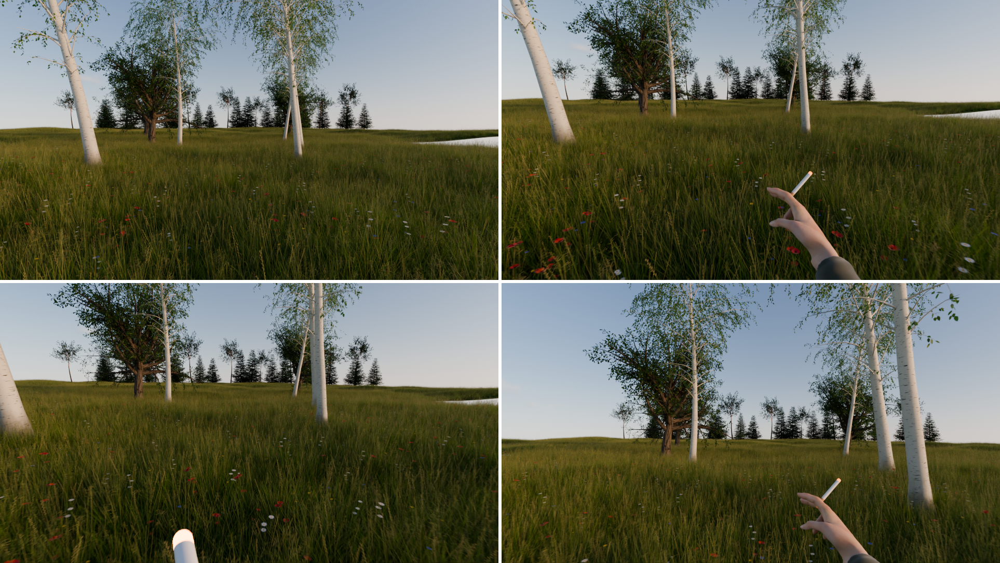
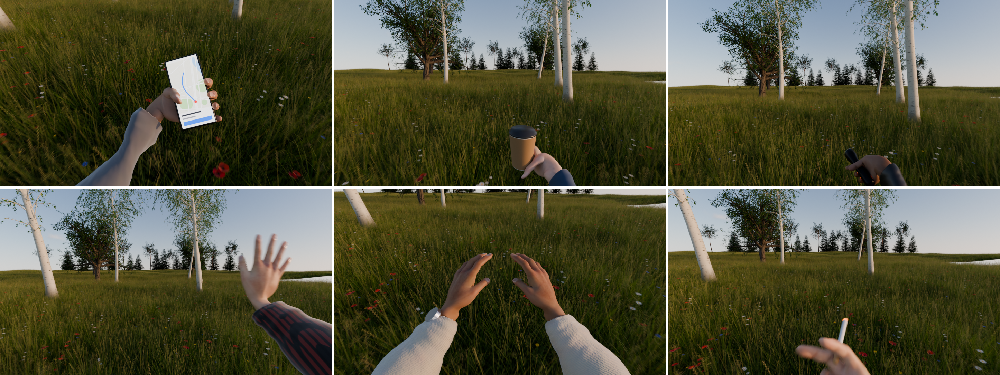

# Stride

**First-person walks for Blender.** Build your scene, click *Create POV
Walk*, drop the End box where you want to go, and a POV camera walks there
over an invisible floor: footsteps, head bob, breathing, looking into
turns, slowing on stairs. Add arms and hands and give them things to do:
smoke a cigarette, check a phone, sip a coffee, light the way with a
flashlight.

Everything is solved in Python and written as plain keyframes, so the walk
renders without the add-on, shows up in the Graph Editor, and exports to
game engines like any animation.

## Quick start

1. Put the 3D cursor where the walk starts and look the way you want to go.
2. **Sidebar → POV → Create POV Walk.** You get a camera, a green *Start*
   box, a red *End* box and a flat invisible floor between them.
3. Move the **End box**. The path, footsteps and timing update live in the
   viewport; scrub the timeline to watch.
4. **Add Waypoint** to route the walk around things. Give a waypoint a
   *Wait* to stop there for a moment.
5. Shape the floor: **Edit Floor Shape** opens the floor in Edit Mode. Pull
   faces up for steps, tilt them for ramps. Or add a ready-made **Stairs**
   floor, walk on **Selected Objects** (terrain, a building), or **Drop onto
   Scene** to make a flat grid follow the geometry under it.
6. **Look Through** and **Fit Timeline**, then render.

## The walk

- **Path**: a smooth curve through Start, the waypoints and End. People
  walk straight, so the curve never overshoots its points.
- **Floor**: the walk finds the floor under every step, tracked from the
  last step so bridges and upper floors don't steal it. Where there's no
  floor it keeps level (drawn red), and with no floor at all it runs
  straight between the boxes' bases.
- **Footsteps**: a whole number of even steps from start to end, drawn on
  the floor. On stairs the body lifts with each step (*Stair Steps* sets
  how much).
- **Speed**: eases in and out of every stop, slows in tight turns and on
  stairs and slopes, and can be set per stretch (*Speed to Next*).
- **Styles**: Stroll, Walk, Brisk, Jog, Run, Sneak (crouched), Gimbal
  (stabilised glide), Bodycam (chest height, shakier) and Wobbly. Each sets
  speed, step length, bob, sway, roll and shake, which you can then tweak.
- **Start and end**: wait at the start, hold at the end (breathing, looking
  around), and optionally face the boxes' arrows before setting off and
  after arriving.
- **Footstep Markers**: a timeline marker on every step, to line up
  footstep sounds.

## The head

- Eyes lead into turns: the head looks at a point a few metres along the
  path and follows with a neck-like lag.
- It turns about the neck, not the lens, so looking down also moves the
  eyes forward and down like a real head.
- Looks up and down slopes, watches its step on stairs, wanders a little
  (*Handheld*) and breathes while standing.
- **Look Moves** on the timeline: Look Left, Look Right, Look Up, Look Down,
  Look Around, Over Left/Right Shoulder, Nod, Shake Head and Look At Object
  (keeps a target in view while walking past it).

## Hands

**Add Hands** gives the walk arms with sleeves: choose skin tone (seven
tones, with lighter palms on darker skin), sleeves (field jacket, hoodie,
denim, leather, flannel, knit sweater, suit with shirt cuff, T-shirt, bare
arms), build (average, slim, strong) and a wristwatch.

The arms are a sculpted, skin-weighted mesh with a painted skin texture
(veins, knuckles, palm lines, nails) that scatters light, rigged to a plain
armature. Arms are solved with
two-bone IK and keyed as plain bone rotations, so the rig exports to game
engines too.

**Actions** start on the current frame and last as long as you like; longer
uses repeat the middle (another drag, another sip):

| Habits | Gestures | Explore |
| --- | --- | --- |
| Smoke a Cigarette (glowing ember, exhaled smoke) | Wave Hello | Flashlight (real spot light) |
| Check Phone (lit screen, scrolling thumb) | Point Ahead | Reach Out and Touch |
| Sip Coffee | Thumbs Up | Shield Eyes |
| Drink from Bottle | Look at Hands | |
| Check Watch | | |
| Warm Hands (rub and breathe) | | |

- *Other Hand* mirrors any action.
- *Head Follows* sets how much the head looks at what the hands do.
- *Hands in View* lifts raised hands into the frame. A camera at your eyes
  sees less than your eyes do; 0 keeps hands where a body would really hold
  them, 1 frames them like a game.
- *Hand Sway* makes held things bob with the steps and lag behind turns.

## Tips

- An 18 mm lens is the default: wide like an action camera, so hands at
  chest height are in view. Longer lenses feel calmer but lose the hands.
- Turn on motion blur for the real handheld feel.
- *Live Update* off freezes the keys so you can edit them by hand.
- Several walks per scene are fine; pick one in the panel's walk selector.

## Requirements

Blender 5.0 or newer. Cycles or EEVEE.

## License

The add-on's code is GPL-3.0-or-later, like all Blender add-ons. See
[LICENSE](LICENSE).

The arm mesh and skin texture are based on
["Rigged Arms"](https://sketchfab.com/3d-models/rigged-arms-76f4c7ae0b3e4cf9a57613ab991fad06)
by [mrgyarmati](https://sketchfab.com/mrgyarmati), licensed under
[CC-BY-4.0](http://creativecommons.org/licenses/by/4.0/) (built on MakeHuman,
CC0). Stride re-poses, refits and re-skins it; see `stride/data/CREDITS.txt`.
